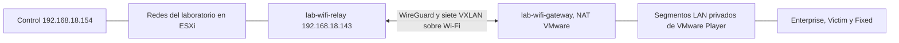

> Transporte actualizado el 2026-10-03: ver [migración Ethernet](../../workstation/WORKSTATION_ETHERNET_MIGRATION.md). WiFi queda como respaldo manual.

# Laboratorio distribuido: ESXi y VMware Player por Wi-Fi

El traslado conserva las IP de las VMs, MAC, claves SSH, nombres de interfaces, namespaces y configuración de servicios. Las direcciones DHCP de Fixed se renuevan y se resuelven por MAC y namespace al preparar cada ejecución. Se exportan apagadas, se verifica el manifiesto SHA-256 y se convierte únicamente la copia de hardware virtual 19 a 18. Los originales permanecen apagados en ESXi para reversión.

## Distribución física

| Destino Windows 192.168.18.45 | vCPU | RAM |
|---|---:|---:|
| victim | 4 | 1 GiB |
| pe | 1 | 1 GiB |
| ent-site-1 … ent-site-5 | 5 en total | 10 GiB en total |
| bng | 1 | 1,5 GiB |
| suscriptor, con fixed1 … fixed10 | 2 | 1 GiB |

Los nueve nodos suman 13 vCPU y 14,5 GiB de RAM. Cada pasarela adicional tiene 2 vCPU y 512 MiB. Radio, Core5G, RIC, Peering, orchestrator y el nodo de control permanecen en ESXi 192.168.18.135. El proyecto sigue en `/home/ubuntu/isp-ddos-ryu` y el dashboard en `http://192.168.18.154:8780`.

## Enlace temporal

WireGuard usa UDP 51871 y `172.31.253.1/30` en ESXi, `172.31.253.2/30` en Windows. VXLAN usa UDP 4789 dentro del túnel, con IDs 800, 801, 804, 805, 806, 807 y 808. Cada VXLAN tiene un puente independiente y exactamente una interfaz del segmento correspondiente. No se transporta directamente un trunk 802.1Q por Wi-Fi.

| VLAN/segmento | Puerto ESXi adicional | LAN privada Player |
|---:|---|---|
| 800 MGMT | LAB-WIFI-800 | LAB-WIFI-800 |
| 801 BB_ACCESS | LAB-WIFI-801 | LAB-WIFI-801 |
| 804 ENT_LAN | LAB-WIFI-804 | LAB-WIFI-804 |
| 805 ENT_DC | LAB-WIFI-805 | LAB-WIFI-805 |
| 806 BACKBONE_MOBILE | LAB-WIFI-806 | LAB-WIFI-806 |
| 807 BACKBONE_FIXED | LAB-WIFI-807 | LAB-WIFI-807 |
| 808 BACKBONE_PEERING | LAB-WIFI-808 | LAB-WIFI-808 |

Solamente esos siete nuevos portgroups permiten recepción promiscua y MAC reenviadas. No se alteraron los portgroups originales ni los uplinks físicos. Las IP de administración de las pasarelas son `10.10.0.252` y `10.10.0.253`. La pasarela Windows obtiene `192.168.126.154` en VMnet8; ambas direcciones del transporte provienen de DHCP y deben comprobarse después de cambios de red.

La MTU interior sigue en 1500. WireGuard tiene MTU 1600 para admitir VXLAN con la MTU interior original; el transporte exterior puede fragmentarse. Se verificaron paquetes ICMP de 1472 bytes de carga y una transferencia TCP de 64 MiB con aproximadamente 178 Mbps. Esa prueba no representa la capacidad garantizada del Wi-Fi ni una recalibración de BENIGN_V1.

## Control y monitoreo

`topology.yaml` declara `placement.hypervisor: workstation` en los nueve nodos. `deploy_govc.sh` omite esos nodos para evitar recrearlos en ESXi. La API de topología publica la ubicación física.

`tools/workstation/workstation_bridge.py` escucha únicamente en `127.0.0.1:18781` en Windows. Un túnel SSH inverso autenticado permite al nodo de control acceder por su propio loopback. No se abrió un puerto público de administración en Windows. `webtool/workstation_ops.py` consulta estados y dirige encendido, apagado y cierre limpio al destino. Ante un fallo de ese canal, muestra estado desconocido y nunca enciende el original en ESXi.

La configuración privada del control está en `.runtime/benign-lab/workstation.json`, con `url`, `token` y lista `vms`. El servidor Windows usa un JSON privado con `vmrun`, `ssh_key`, `token` y el mapa de nombres a archivos VMX absolutos. Los tokens y claves no se versionan.

Los ejecutores y las sondas continúan por SSH desde el control hacia las IP originales. Las gráficas de interfaces, logs y métricas siguen identificando los mismos nodos. Las diez sesiones Fixed continúan aisladas en namespaces dentro de `suscriptor`. También se añadieron sondas SSH por clave para las dos pasarelas; el dashboard recoge los 26 nodos, incluyendo esos enlaces nuevos.

## Reproducibilidad

No se modificaron perfiles, capacidades de referencia ni semillas. El plan de 600 s, BENIGN_V1 y semilla 1 conserva:

- `plan_hash`: `2c3580be4272c69a94c0ee39a990b0d33b9aa8654f60ab35d120283d2e118245`.
- SHA-256 del archivo materializado: `3a2b8445f025bd6e1625baf6901f024b10d07567beac12d633e09e665b1fa9dc`.
- Ground truth en ventanas de 5 s.

Las mediciones durante esta etapa deben indicar transporte Wi-Fi. Una variación de rendimiento puede provenir del enlace, además de la distribución de CPU.

## Arranque, recuperación y enlace Ethernet futuro

Mantener Windows encendido y conectado al Wi-Fi. Arrancar primero las pasarelas, comprobar el handshake de WireGuard y `10.10.0.253` desde el control; después Victim, PE, Enterprise, BNG y `suscriptor`. Iniciar el servidor local y su túnel SSH con los scripts y JSON privados. Si cambia la IP DHCP de `lab-wifi-relay`, actualizar `Endpoint` en `/etc/wireguard/wg0.conf` de la pasarela Windows y recargar el peer.

Para revertir un nodo: apagar y comprobar detenida su copia Player, quitar su nombre del backend privado, cambiar su placement a ESXi y entonces encender el original con govc. Nunca mantener ambas copias encendidas: comparten IP y MAC. Si se revierte todo, desactivar primero los enlaces VXLAN y las pasarelas para retirar el puente entre hosts.

Cuando exista acceso físico, conectar Ethernet 2 de Windows a un vmnic libre del servidor. Añadir un enlace de transporte privado entre una NIC nueva de la pasarela ESXi y Windows, con un vSwitch dedicado, sin modificar el uplink de gestión actual. Cambiar el endpoint WireGuard al enlace cableado después de validar sus IP, rutas y MTU. Se pueden conservar los siete VXLAN y todas las IP del laboratorio; luego medir el enlace de 1 Gbps antes de comparar resultados. En el JSON privado del control, `relay_network` selecciona el nuevo portgroup del transporte cableado; su valor predeterminado es `VM Network` para el Wi-Fi actual.

Player 16.1.0 arrancó las copias importadas en este equipo. Este resultado práctico no cambia la limitación de compatibilidad de esa versión antigua con Windows 11.

## Compatibilidad IPoE después del reinicio

BNG usaba el kernel 5.15.0-191 antes del traslado y arrancó con el 5.15.0-194 que ya estaba instalado en su disco. Faltaba el módulo `ipoe.ko` para el kernel nuevo. Se compiló únicamente ese módulo desde `/opt/accel-ppp-src`, se instaló, se cargó y se reinició `accel-pppd`.

El guard `/usr/local/sbin/ensure-ipoe-module`, versionado en el rol Ansible de BNG, se ejecuta antes del daemon. Cuando existe un módulo compatible, solo lo carga; compila únicamente si falta el módulo del kernel actual. Requiere las cabeceras de ese kernel y las herramientas de compilación. El CLI de este laboratorio usa `accel-cmd -p 2000 show sessions`.

## Validación final

- Nueve VMs originales apagadas en ESXi; nueve copias encendidas en Player.
- Once nodos Mobile/Core/RIC siguen encendidos en ESXi.
- Los 26 colectores de interfaces del dashboard están conectados.
- Diez direcciones Fixed únicas coinciden con diez sesiones IPoE activas en BNG.
- Prueba funcional `20261002T182530-5fa2bd19`: 21 generadores, 126 eventos TCP/HTTP/UDP en ambas direcciones, 75.600 bytes transmitidos y 75.600 recibidos; estado completed sin errores.
- La prueba corta anterior de 3 s terminó los 126 eventos, con siete avisos de volumen en Mobile por su plazo ajustado. La prueba final usa 6 s y una transferencia de 1.200 bytes por evento, coherente con su tasa de 1.600 bps. Ninguna sustituye al baseline científico de 600 s.
- Detección y mitigación restauradas al finalizar. Plan científico y ventanas de 5 s preservados.
- 39 pruebas de la herramienta y cinco pruebas del backend y del inventario ESXi pasaron.

El arranque Windows puede ejecutarse con `workstation_bootstrap.py --config <JSON privado>`. Descubre el endpoint actual de la pasarela ESXi, comprueba que cada original esté apagado, arranca primero la pasarela local y después las copias disponibles; reutiliza o inicia el canal de administración. El JSON agrega `python`, `gateway_vmx`, `gateway_underlay` y `gateway_known_hosts` a los campos descritos arriba.

Las VMs Windows y sus archivos privados están actualmente en la carpeta de esta sesión Codex, bajo `work/migration/`. Esa carpeta contiene los discos activos y no debe borrarse. El informe entregado contiene las rutas absolutas y se entrega un lanzador de arranque para este equipo.

Si se revierte BNG a su original, ese disco también contiene el kernel nuevo sin el módulo correspondiente. Tras apagar su copia Player y encender el original, ejecutar desde el control `python3 deploy/vm-lab/scripts/install_bng_kernel_guard.py` para instalar el mismo guard y módulo antes de restablecer las sesiones.
