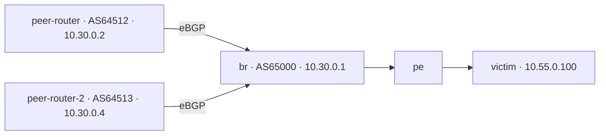

# Segundo AS generador de Internet Peering

Se añadió peer-router-2 como VM nativa de VMware Player en la PC 192.168.18.45: 2 vCPU, 2048 MiB, disco independiente de 15 GiB, MAC 00:50:56:3a:b2:04, IP 10.30.0.4/29, router-id 10.30.0.4 y AS64513. El primer peer mantiene 10.30.0.2/29 y AS64512. Ambos establecen su propia sesión eBGP con br, AS65000/10.30.0.1.

## Asignación del tráfico

config/lab.connected.yaml contiene peering_pool.strategy=logical_source_round_robin_v1 y members=[peer-router,peer-router-2]. Para cada plan se ordenan los identificadores de fuentes lógicas Peering y se asignan alternadamente. Todos los eventos de una fuente lógica mantienen el mismo ejecutor, incluidas sus direcciones UL y DL. La asignación no depende del orden de los eventos, del estado de ejecución ni de un RNG nuevo. No hay fallback silencioso a un único router si el otro falla.

Los tres planes de referencia tienen 100 fuentes lógicas: 50 por router en cada semilla. El número de eventos y bytes de cada fuente puede variar, así que el reparto exacto de fuentes no garantiza igualdad instantánea de Mbps. Los bytes totales permanecen iguales y la capacidad Peering configurada sigue siendo el total del dominio, no una capacidad por VM. No se duplican tasas ni cuotas.

| Semilla | Eventos peer-router | Eventos peer-router-2 | Bytes peer-router | Bytes peer-router-2 |
|---|---:|---:|---:|---:|
| 1 | 2098 | 2146 | 1496902944 | 1515994955 |
| 2 | 2197 | 2268 | 1497639938 | 1515257928 |
| 3 | 1957 | 1964 | 1487219874 | 1525678157 |

No se modifican benign_plan.json, sus hashes, BENIGN_V1, semillas ni ground truth de 5 s. El mapeo físico y lab_hash cambian y deben conservarse como condición experimental distinta. Configuraciones anteriores sin peering_pool siguen usando su ejecutor único.

## Observabilidad y despliegue

El runtime registra executor_name/source_as por evento y source_ip real; el dashboard muestra el router, AS y dirección. execution_mapping.json registra el contexto por generador. Tráfico y recursos de peer-router-2 se incluyen en los monitores existentes. softflowd del br captura ambos orígenes en ens192; no se añadieron colectores competidores.

La topología incluye bgp_as por VM, las plantillas BIRD usan router-id por host y br genera sus vecinos desde bgp_external_peers. render_topology.py produce variables por AS e inventario con ambos peers. El arranque y backend de Workstation incluyen peer-router-2; native_vms permite su arranque sin un original ESXi, y sigue impidiendo duplicar originales encendidos. El script de rollout del agente contempla la VM nueva.

Control tiene una ruta /32 hacia 10.30.0.4 via 10.10.0.3 y se conserva la correspondiente a .2. El guest nuevo tiene rutas administrativas/NTP vía br. Se corrigió el next-hop NTP antiguo heredado del clon y se confirmó NTPSynchronized=yes. Nombre, machine-id y claves SSH de host se regeneraron durante provisión aislada. El segmento NAT y túneles temporales se retiraron antes de validar producción.

## Validación

146 pruebas aprobadas: estabilidad y reparto de fuentes, conservación del plan, compatibilidad del ejecutor único, benchmarks y regresiones existentes. La suite detectó y permitió corregir compatibilidad de payload_quality con registros históricos sin mode, usando confirmación conservadora.

Sesiones BGP de .2/AS64512 y .4/AS64513 Established simultáneamente. El contador de caídas de la sesión original siguió en cero. peer-router-2 importa dos prefijos y exporta su default, con su propio AS.

Smoke diagnóstico 20261007T131718-8f14266e: 20 s, dos fuentes lógicas, UL/DL por cada peer, cuatro transferencias de 8192 bytes completas y confirmadas (32768 bytes), sin shortfall. IP de origen y AS coinciden con el router asignado. Pipeline restaurado. NetFlow decodificado contiene registros de ambos orígenes hacia victim:9001; el dashboard recibió muestras nuevas de recursos de la VM.

Esta validación es de funcionamiento y reparto, no un benchmark de capacidad máxima ni una demostración de mejora estadística. No se iniciaron automáticamente las 18 corridas. Puedes reutilizar los mismos planes y el botón de comparación; la nueva serie tendrá dos AS y debe analizarse separadamente del escenario de un solo peer.

## Reversión

Detener pruebas. Retirar peering_pool y los nodos explícitos nuevos para volver al wildcard peer-flow* original (10.30.0.2), conservando evidencias y planes. Retirar el vecino .4/AS64513 de br y apagar peer-router-2 en Workstation antes de retirarlo de topología/backend/arranque y monitores. Retirar la ruta /32 de .4 en control; conservar .2 y br. Restaurar las plantillas/versiones previas si se desea volver completamente al inventario de un peer. No encender un duplicado de la VM nueva ni cambiar el peer original como parte de esta reversión.
